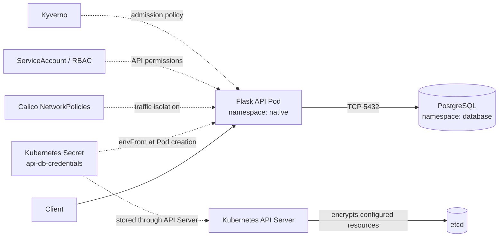
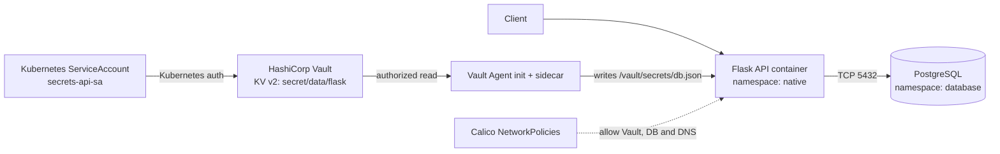

# Kubernetes Secrets Management — Native Secrets vs HashiCorp Vault

> **Educational DevSecOps lab** using Kind, Kubernetes, Flask, PostgreSQL, Calico, Kyverno and HashiCorp Vault Agent Injector. Vault is run in **development mode only**. External Secrets Operator (ESO) is discussed but **not deployed**.

## Goals

- Demonstrate Kubernetes Secret storage **without** and **with** encryption at rest (AES-CBC).
- Compare reading a Secret through the Kubernetes API and reading the raw record directly from etcd.
- Apply defense in depth: least-privilege ServiceAccounts/RBAC, Kyverno Pod admission rules and Calico NetworkPolicies.
- Compare native Kubernetes Secret injection via environment variables with Vault Agent Injector file-based delivery.
- Demonstrate static KV secret refresh and behavior of an already-running application during a temporary Vault network outage.

## Architecture 1 — Native Kubernetes Secrets



Kubernetes Secret `data` fields are Base64-encoded in API responses; Base64 is **not encryption**. The main Kind cluster uses an `EncryptionConfiguration` that encrypts `secrets` at rest before they are written to etcd. RBAC remains necessary because authorized API clients receive decrypted Secret values.

## Architecture 2 — Vault Agent Injector



Vault role `flask-role` is bound to `secrets-api-sa` in namespace `native`; policy `flask-policy` permits `read` on `secret/data/flask` only. The application reads `/vault/secrets/db.json` instead of obtaining database credentials from `DB_*` environment variables.

## Repository layout

```text
app/                             Flask app, Dockerfile, requirements
kind/cluster.yaml                Main Kind cluster (Calico, encryption)
kind/etcd-demo/cluster.yaml      Single-node Kind cluster for unencrypted baseline
kind/encryption/                Local encryption configuration (DO NOT COMMIT REAL KEYS)
database/postgres/               PostgreSQL Deployment, PVC, Service
k8s/native/deployment.yaml       Native Flask Deployment
k8s/kyverno/restrict-pods.yaml   Pod admission policy
k8s/networkpolicies/             Native/database traffic restrictions
k8s/vault/                       Vault-injected Deployment and NetworkPolicies
vault/flask-policy.hcl           Vault least-privilege policy
```

## Prerequisites

Linux or WSL2 with Docker, `kind`, `kubectl`, Helm, `curl`, and a container runtime; enough memory for two Kind nodes, Calico, Kyverno, Vault, PostgreSQL and Flask. Commands below assume the repository is cloned into `~/secrets-lab`; `kind/cluster.yaml` currently contains an **absolute hostPath** pointing there. Adjust that path for your environment.

**Never commit** real AES keys, PostgreSQL passwords, Vault tokens, private keys, certificate directories or `.env` files. The original AES key used in the lab has been displayed in a conversation and should be **rotated**, not reused in a public repository. A key stored alongside encrypted etcd data weakens protection against host compromise. AES-CBC encryption at rest is a lab demonstration, not a complete production hardening strategy.

## 1. Demonstrate unencrypted etcd baseline

```bash
kind create cluster --config kind/etcd-demo/cluster.yaml
kubectl config use-context kind-etcd-demo
kubectl create namespace demo
kubectl create secret generic demo-secret -n demo \
  --from-literal=password=DemoPassword123

# Authorized read through Kubernetes API
kubectl get secret demo-secret -n demo -o jsonpath='{.data.password}' | base64 -d; echo

# Check encryption provider is absent
docker exec etcd-demo-control-plane sh -c \
  'grep encryption-provider-config /etc/kubernetes/manifests/kube-apiserver.yaml || echo "No encryption provider flag"'

# Direct etcd read: the kubectl exec transport enters the etcd Pod,
# but etcdctl reads etcd directly (not the Kubernetes Secret API).
kubectl exec -n kube-system etcd-etcd-demo-control-plane -- \
  etcdctl --endpoints=https://127.0.0.1:2379 \
  --cacert=/etc/kubernetes/pki/etcd/ca.crt \
  --cert=/etc/kubernetes/pki/etcd/healthcheck-client.crt \
  --key=/etc/kubernetes/pki/etcd/healthcheck-client.key \
  get /registry/secrets/demo/demo-secret --print-value-only \
  | strings | grep DemoPassword123
```

Expected: `DemoPassword123` can be found in the raw record. Use **fake credentials only** for this demonstration.

## 2. Create main Kind cluster with AES-CBC at rest

Before creating the cluster, ensure `kind/encryption/encryption-config.yaml` exists locally and is **not tracked by Git**. Generate a fresh key for the local lab, for example:

```bash
mkdir -p kind/encryption
KEY="$(head -c 32 /dev/urandom | base64 -w0)"
cat > kind/encryption/encryption-config.yaml <<EOF_KEY
apiVersion: apiserver.config.k8s.io/v1
kind: EncryptionConfiguration
resources:
  - resources:
      - secrets
    providers:
      - aescbc:
          keys:
            - name: key1
              secret: ${KEY}
      - identity: {}
EOF_KEY
unset KEY
chmod 600 kind/encryption/encryption-config.yaml
```

The existing `kind/cluster.yaml` mounts this file into the API server and has `disableDefaultCNI: true`, so install Calico after cluster creation.

```bash
kind create cluster --config kind/cluster.yaml
kubectl config use-context kind-secrets-lab
kubectl get nodes -o wide   # NotReady before installing Calico can be expected

docker exec secrets-lab-control-plane grep encryption-provider-config \
  /etc/kubernetes/manifests/kube-apiserver.yaml
kubectl create namespace native
kubectl create namespace database
kubectl create namespace vault
kubectl create secret generic encryption-demo -n native \
  --from-literal=password=DemoPassword123

# Kubernetes API: still readable to an authorized user
kubectl get secret encryption-demo -n native \
  -o jsonpath='{.data.password}' | base64 -d; echo

# Direct etcd: look for encryption marker
kubectl exec -n kube-system etcd-secrets-lab-control-plane -- \
  etcdctl --endpoints=https://127.0.0.1:2379 \
  --cacert=/etc/kubernetes/pki/etcd/ca.crt \
  --cert=/etc/kubernetes/pki/etcd/healthcheck-client.crt \
  --key=/etc/kubernetes/pki/etcd/healthcheck-client.key \
  get /registry/secrets/native/encryption-demo --print-value-only \
  | strings | grep 'k8s:enc:'
```

Expected marker: `k8s:enc:aescbc:v1:key1:`. To inspect binary ciphertext, replace the final `strings | grep ...` with `xxd -l 160`. The record contains an encrypted serialized Secret object, not just an encrypted password field.

## 3. Install Calico and deploy the native app

**Use the Calico installation manifest/version verified for your Kind/Kubernetes version.** The original lab used a Calico CNI with Pod CIDR `192.168.0.0/16`; its exact installation URL is not stored in this README, so do not substitute an arbitrary release.

```bash
# After installing the compatible Calico manifests:
kubectl wait --for=condition=Ready nodes --all --timeout=300s
kubectl get pods -A

# Inspect existing files before applying; PostgreSQL credentials are created
# separately and are not supplied in this public repository.
find database k8s -type f | sort
```

Create a local PostgreSQL Secret and matching native API Secret with credentials that match the Deployment environment variable references. **Inspect the existing YAML files for exact secret names and keys before running**:

```bash
kubectl create secret generic postgres-credentials -n database \
  --from-literal=POSTGRES_USER=app_user \
  --from-literal=POSTGRES_PASSWORD='REPLACE_WITH_LOCAL_PASSWORD' \
  --from-literal=POSTGRES_DB=secretslab

kubectl create secret generic api-db-credentials -n native \
  --from-literal=DB_HOST=postgres.database.svc.cluster.local \
  --from-literal=DB_PORT=5432 \
  --from-literal=DB_NAME=secretslab \
  --from-literal=DB_USER=app_user \
  --from-literal=DB_PASSWORD='REPLACE_WITH_SAME_LOCAL_PASSWORD'

kubectl apply -f database/postgres/pvc.yaml
kubectl apply -f database/postgres/deployment.yaml
kubectl apply -f database/postgres/service.yaml

docker build -t secrets-lab-api:v2 ./app
kind load docker-image secrets-lab-api:v2 --name secrets-lab
kubectl apply -f k8s/native/deployment.yaml
kubectl get pods -n database
kubectl get pods -n native
```

In a dedicated terminal:

```bash
kubectl port-forward -n native deployment/secrets-api 5000:5000
```

In another terminal:

```bash
curl -i http://127.0.0.1:5000/health
curl -i http://127.0.0.1:5000/db-check
```

Expected `/db-check` JSON: `{"database":"connected","status":"success"}`.

## 4. ServiceAccount and RBAC

```bash
kubectl get serviceaccount -n native
kubectl get roles,rolebindings -n native
kubectl auth can-i get secrets \
  --as=system:serviceaccount:native:secrets-api-sa -n native
kubectl auth can-i list secrets \
  --as=system:serviceaccount:native:secrets-api-sa -n native
```

Expected `no` for both when no Secret-reading RoleBinding exists. Secret environment injection by the kubelet does **not** require granting the application ServiceAccount `get secrets` API permission.

## 5. Kyverno Pod security policy

Install a compatible Kyverno release first (via Helm or your verified installation instructions), then:

```bash
kubectl apply -f k8s/kyverno/restrict-pods.yaml
kubectl get policies -n native
kubectl get clusterpolicies
```

Demonstrate that a non-compliant Pod is rejected **if the policy matches the namespace and is enforced**. The existing policy requires non-root execution and rejects privileged containers and `hostPath` volumes. Do not assume rejection without checking the policy's validation mode.

## 6. Calico NetworkPolicies

```bash
kubectl apply -f k8s/networkpolicies/security-policies.yaml
kubectl get networkpolicies -A
kubectl describe networkpolicy -n native
kubectl describe networkpolicy -n database
```

Test `/db-check` before and after `default-deny`, then after adding explicit TCP/5432 and DNS permissions. Note that NetworkPolicies apply to Pods selected by their selectors; policy application is asynchronous. A separate diagnostic Pod is useful to demonstrate denied connections.

## 7. Vault dev mode + Kubernetes Auth

```bash
helm repo add hashicorp https://helm.releases.hashicorp.com
helm repo update
helm install vault hashicorp/vault -n vault \
  --set server.dev.enabled=true \
  --set server.dev.devRootToken=root \
  --set injector.enabled=true
kubectl get pods -n vault
```

**Development only:** root token `root`, in-memory secrets, no production persistence. Restarting `vault-0` loses secrets and configuration.

For demo credentials, enter Vault:

```bash
kubectl exec -it -n vault vault-0 -- sh
```

Then inside the Vault Pod (use the **same local PostgreSQL password** as in step 3):

```bash
vault secrets list
# Enable KV v2 only if 'secret/' does not already exist:
# vault secrets enable -path=secret kv-v2
vault kv put secret/flask \
  DB_HOST=postgres.database.svc.cluster.local DB_PORT=5432 \
  DB_NAME=secretslab DB_USER=app_user \
  DB_PASSWORD='REPLACE_WITH_SAME_LOCAL_PASSWORD'
vault policy write flask-policy - <<'EOF_POLICY'
path "secret/data/flask" {
  capabilities = ["read"]
}
EOF_POLICY
vault auth enable kubernetes
```

Configure Kubernetes auth using the cluster's API endpoint, CA and a valid token-reviewer strategy **before** creating/testing the role. The exact Vault auth setup depends on the cluster and chart configuration; verify it rather than copying an unverified command. Then:

```bash
vault write auth/kubernetes/role/flask-role \
  bound_service_account_names=secrets-api-sa \
  bound_service_account_namespaces=native \
  policies=flask-policy ttl=1h
vault policy read flask-policy
vault read auth/kubernetes/role/flask-role
exit
```

## 8. Vault Agent Injector

The existing `k8s/vault/deployment-vault.yaml` includes annotations such as:

```yaml
vault.hashicorp.com/agent-inject: "true"
vault.hashicorp.com/role: "flask-role"
vault.hashicorp.com/agent-inject-secret-db.json: "secret/data/flask"
```

The agent template writes JSON into `/vault/secrets/db.json`. Apply network permissions **before** starting the Vault-injected Pod, especially when `default-deny` is active:

```bash
kubectl apply -f k8s/vault/vault-networkpolicy.yaml
kubectl apply -f k8s/vault/vault-postgres-ingress.yaml
kubectl apply -f k8s/vault/deployment-vault.yaml
kubectl get pods -n native
kubectl describe deployment secrets-api-vault -n native
kubectl exec -n native deployment/secrets-api-vault -c api -- \
  test -s /vault/secrets/db.json && echo 'Vault secret file injected'
```

Test in separate terminals:

```bash
kubectl port-forward -n native deployment/secrets-api-vault 5001:5000
# In another terminal:
curl -i http://127.0.0.1:5001/health
curl -i http://127.0.0.1:5001/db-check
```

## 9. Refresh and resilience tests

**Static secret refresh** (not PostgreSQL password rotation):

```bash
kubectl exec -n vault vault-0 -- vault kv patch secret/flask rotation_test=version2
# Wait for Vault Agent refresh, then:
kubectl exec -n native deployment/secrets-api-vault -c api -- \
  python -c 'import json; print(json.load(open("/vault/secrets/db.json")).get("rotation_test"))'
```

Expected eventually: `version2` without a Pod restart. The Flask application reads the file on request.

**Resilience:** back up `allow-vault-api-egress` and temporarily remove the rule permitting TCP/8200 to Vault while leaving PostgreSQL and DNS allowed. The previously running Flask process may still serve `/health` and `/db-check` using its already-injected file. Restore the NetworkPolicy immediately after the test. This **does not** prove that a new Pod can start without Vault.

## Comparison

| Aspect | Native Secrets | Vault Agent Injector | External Secrets Operator |
|---|---|---|---|
| Implemented in this lab | Yes | Yes | No (theoretical comparison) |
| Secret source | Kubernetes Secret | Vault KV v2 | External provider synced to Kubernetes Secret |
| Delivery to app | Environment variables | Injected file | Usually Kubernetes Secret via env/volume |
| Secrets stored in etcd | Yes | No additional application Secret required by this pattern | Typically yes, synced Secret |
| Access controls | Kubernetes RBAC + Pod/namespace isolation | Vault policy + Kubernetes auth | Provider access + Kubernetes RBAC |
| Rotation/refresh | Usually Pod restart for env changes | Agent can refresh static file | Reconciliation refreshes Kubernetes Secret; app consumption still matters |

**Selected approach for the lab: Vault Agent Injector**, because it allows centralized access policies and file delivery without copying the application database credentials into an additional Kubernetes Secret. This is a lab trade-off, not a universal recommendation.

## Recording checklist

1. Unencrypted `etcd-demo`: API vs raw etcd.
2. Encrypted `secrets-lab`: API vs raw etcd (AES-CBC marker).
3. Native Flask → PostgreSQL success.
4. RBAC deny; Kyverno rejection; NetworkPolicy block/allow.
5. Vault KV + Kubernetes Auth + least-privilege role.
6. Agent-injected JSON file; Flask → PostgreSQL success.
7. Static secret refresh; Vault network isolation and recovery.
8. Final comparison and limitations.

## Security and limitations

- **Never** commit `.etcd-*-certs/`, `.key`, `.env`, Vault tokens, live encryption configs, passwords, or private kubeconfigs.
- A Git ignore rule does **not** remove files already committed: check `git ls-files`, `git log` and GitHub history before publishing.
- If a secret was committed, rotate it and purge it from Git history before publication.
- This is a **local educational lab**. Vault dev mode, hardcoded demo tokens, and local encryption keys are not production practices.
- The source tree contains infrastructure manifests but does not contain all imperative setup steps (e.g., original Calico install and full Vault Kubernetes Auth configuration). Verify the actual manifest keys and versions before running every command.

## License

Add a license file if you want to grant reuse permissions. No license is assumed by this README.
